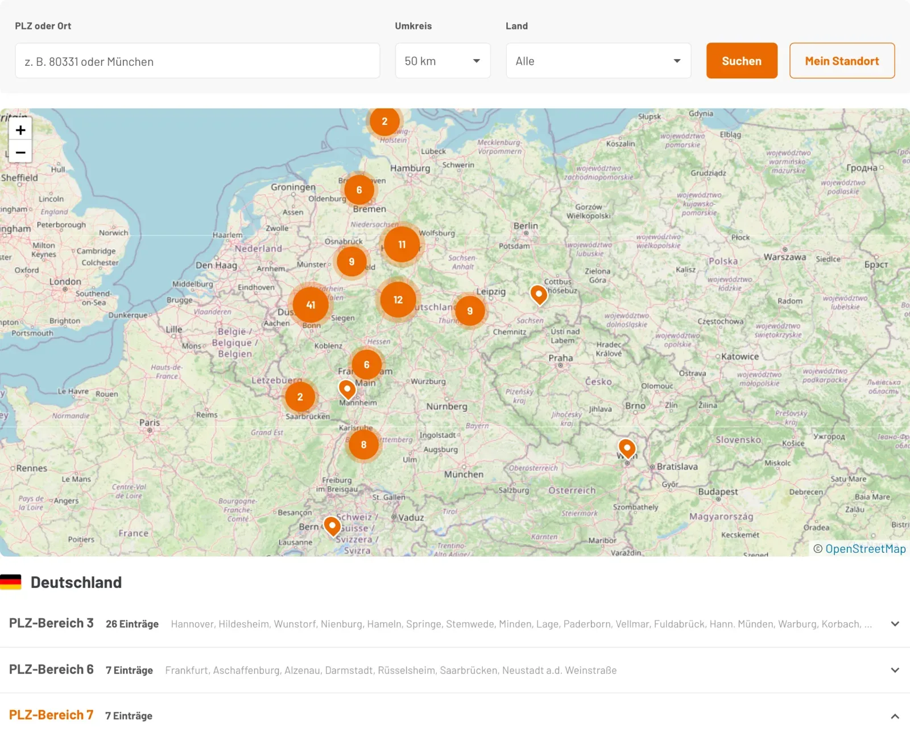

# GratMap

Standortkarte für Contao 5.7: Händler, Niederlassungen, Ansprechpartner – als Karte (Leaflet, Cluster) und/oder
Liste mit Umkreissuche, Länder- und Kategorienfilter. Mehrsprachig, mehrere Länder, datenschutzfreundlich.



- Paket: `gratlinie/contao-gratmap`, Namespace `Gratlinie\GratMapBundle`, Präfix `gm`
- Voraussetzungen: PHP ≥ 8.2, Contao 5.7

## Installation

```bash
composer require gratlinie/contao-gratmap:^1.0
php vendor/bin/contao-console contao:migrate
```

Oder im Contao Manager nach „GratMap“ suchen, installieren und die Datenbank aktualisieren.

Lokale Entwicklung mit Path-Repository:

```bash
composer config repositories.gratmap '{"type":"path","url":"/pfad/zu/GratMap/bundle","options":{"symlink":true}}'
composer require gratlinie/contao-gratmap:@dev
```

Dokumentation: [docs/gratmap.md](docs/gratmap.md)

## Lizenz

MIT, siehe [LICENSE](LICENSE). Mitgelieferte Bibliotheken: Leaflet (BSD-2-Clause), Leaflet.markercluster (MIT),
flag-icons (MIT), Ländergeometrie von Natural Earth (gemeinfrei) – Lizenzhinweise in `public/vendor/`.
