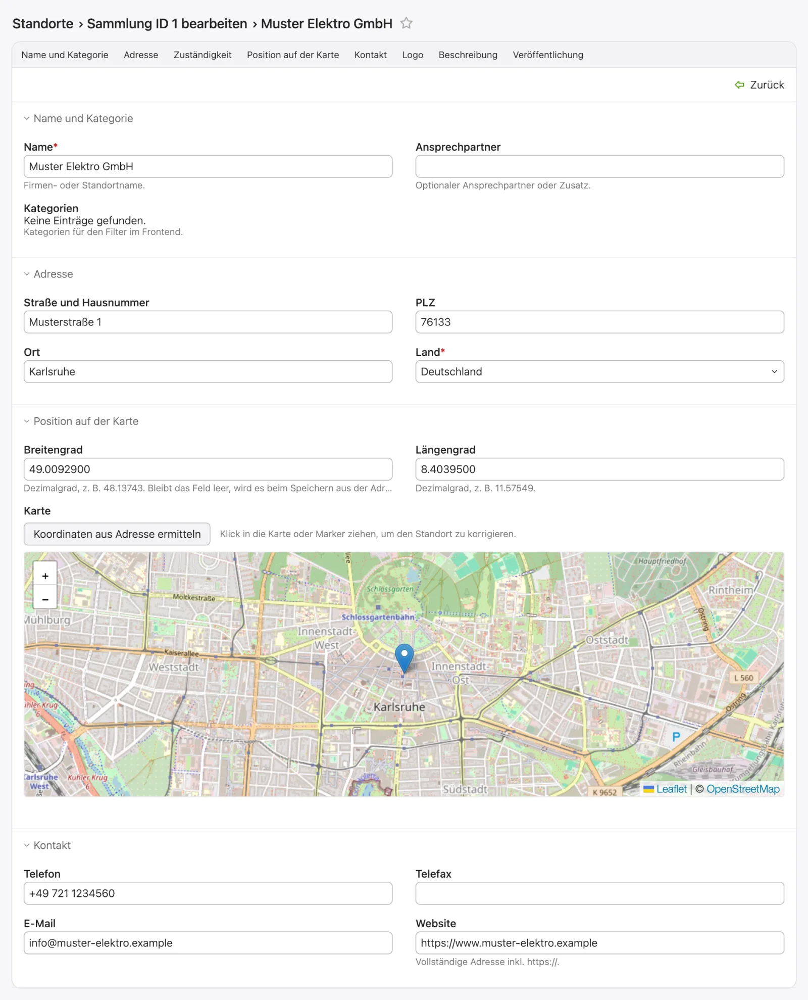
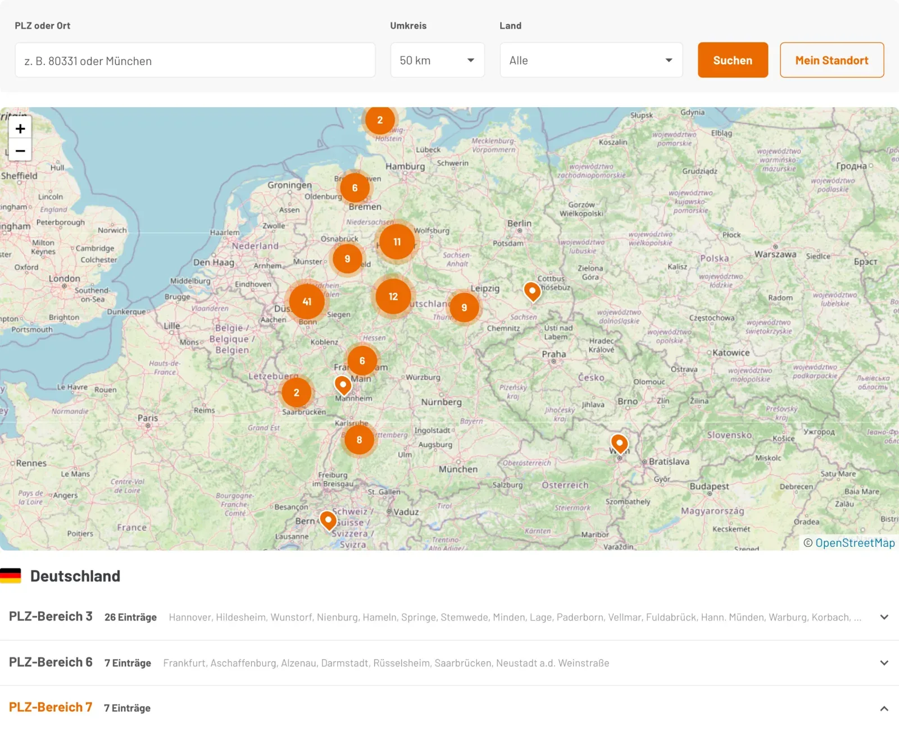
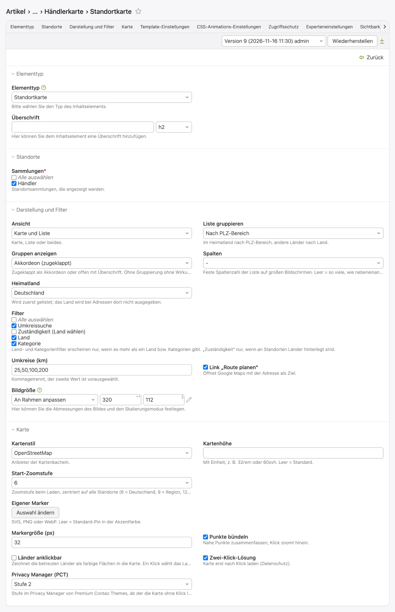

# GratMap – Standortkarte

## Daten pflegen

**GratMap → Standorte** im Backend (eigene Gruppe mit Pin-Icon direkt unter „Inhalte“).

- **Sammlung** – z. B. „Händler“ oder „Niederlassungen“. Ein Inhaltselement kann mehrere Sammlungen zeigen.
- **Kategorien** (Ordner-Symbol an der Sammlung) – optional, z. B. „Fachhändler“, „Vertrieb“. Werden im
  Frontend als Filter angeboten.
- **Standort** – Name, Ansprechpartner, Adresse mit **Land**, Kontakt, Logo, Text, Veröffentlichung.
- **Zuständigkeit** – optional: Länder, die dieser Standort betreut (siehe unten).

### Koordinaten



- Bleiben Breiten-/Längengrad leer, ermittelt GratMap sie beim Speichern aus der Adresse
  (OpenStreetMap/Nominatim, serverseitig, 30 Tage gecacht). Findet sich nichts, erscheint ein Hinweis.
- Im Abschnitt „Position auf der Karte“ lässt sich der Punkt per Klick oder Ziehen korrigieren;
  „Koordinaten aus Adresse ermitteln“ fragt die Adresse erneut ab.
- Standorte ohne Koordinaten erscheinen nur in der Liste, nicht auf der Karte und nicht in der Umkreissuche.

### Zuständigkeit

Betreut ein Standort mehrere Länder – Vertriebsgebiet, Exportmarkt, Ansprechpartner je Land –, gehören diese
Länder ins Feld **„Zuständig für diese Länder“** am Standort. Ein Büro in Augsburg kann so 78 Länder abdecken,
ohne dass es 78-mal angelegt wird; eine geänderte Telefonnummer wird einmal gepflegt.

Das Feld ist unabhängig vom Feld **Land** in der Adresse: dort steht, wo der Standort *liegt*, hier, für wen er
*zuständig* ist. Ein Land darf bei mehreren Standorten stehen – dann zeigt der Filter alle.

## Inhaltselement „Standortkarte“



| Feld | Wirkung |
|---|---|
| Sammlungen | Welche Standorte gezeigt werden |
| Ansicht | Karte und Liste / nur Karte / nur Liste |
| Liste gruppieren | Nach Kontinent, nach Land, nach PLZ-Bereich oder gar nicht. Bei PLZ-Bereich: Heimatland nach erster Ziffer, andere Länder nach Land. Gruppen erscheinen als zugeklappte Akkordeons mit Anzahl und Ortsvorschau; ohne Gruppierung als flache Liste. Gibt es PLZ-Bereiche und andere Länder, trennt die Liste in zwei Abschnitte: Heimatland (mit Flagge) und „Weitere Länder“; Ländergruppen tragen ihre Flagge |
| Gruppen anzeigen | Akkordeon (zugeklappt, Anzahl und Orte im Kopf) oder offen mit Überschrift und allen Einträgen. Ohne Gruppierung ohne Wirkung |
| Spalten | Feste Spaltenzahl (2–6) ab 60 rem Breite. Leer = so viele, wie nebeneinander passen (Mindestbreite `--gm-columns`) |
| Heimatland | Wird zuerst gelistet; bei Adressen dort entfällt die Landesangabe |
| Filter | Umkreissuche, Zuständigkeit, Land, Kategorie. Land erscheint erst ab zwei Ländern, Kategorie nur wenn es welche gibt, Zuständigkeit nur wenn an Standorten Länder hinterlegt sind |
| Umkreise (km) | Kommagetrennt (auch Leer-/Semikolon), wird beim Speichern sortiert; der zweite Wert ist vorausgewählt |
| Link „Route planen“ | Google-Maps-Route zur Adresse (öffnet neuen Tab) |
| Bildgröße | Größe der Logos in der Liste |
| Kartenstil | Kachel-Anbieter (siehe unten) |
| Kartenhöhe | Mit Einheit (`32rem`, `60svh` …), leer = `clamp(22rem, 60svh, 40rem)` |
| Start-Zoomstufe | 2–18, zentriert auf alle Standorte (6 ≈ Deutschland, 9 ≈ Region, 12 ≈ Stadt); leer = automatisch passend. Gilt ohne aktive Suche/Filter |
| Eigener Marker | SVG/PNG/WebP; Spitze unten mittig. Leer = Pin in der Akzentfarbe |
| Punkte bündeln | Cluster; Klick auf einen Cluster zoomt hinein |
| Länder anklickbar | Zeichnet die betreuten Länder als Flächen in die Karte (siehe unten). Setzt den Filter „Zuständigkeit“ voraus |
| Zwei-Klick-Lösung | Karte (Kacheln) erst nach Klick laden, optional „immer laden“ (localStorage) |
| Privacy Manager (PCT) | Stufe im Privacy Manager von Premium Contao Themes (Standard 2, wie OpenStreetMap dort). Ist er auf der Seite aktiv, lädt die Karte ohne Klick, sobald die Stufe freigegeben ist. GratMap wartet dafür bis kurz nach dem `load`-Event, weil manche Themes den Privacy Manager erst nach `gratmap.js` ausliefern – auch direkt nach der Auswahl im Opt-in. Ohne Freigabe zeigt der Platzhalter „Karte laden“ (einmalig) und „Datenschutz-Einstellungen ändern“. Leer = PCT ignorieren |




### Gruppierung nach Kontinent

Die Zuordnung Land → Kontinent folgt der UN-M49-Einteilung und liegt als feste Tabelle im Bundle
(`src/Map/Continents.php`), also ohne Netzabfrage zur Laufzeit. Reihenfolge der Gruppen: Europa,
Nordamerika, Südamerika, Asien, Afrika, Ozeanien, Antarktis; innerhalb einer Gruppe steht das
Heimatland vorn. Bei dieser Gruppierung trägt jede Karte ihr Land, auch im Heimatland.

Zusammen mit „Gruppen anzeigen: offen“ und einer festen Spaltenzahl ergibt das ein Verzeichnis
ohne Klickarbeit – sinnvoll, wenn es viele Standorte in vielen Ländern gibt.

### Zuständigkeitsfilter

Das Auswahlfeld „Ihr Land“ listet alle Länder, die an irgendeinem Standort hinterlegt sind, in der Sprache der
Seite. Nach der Auswahl bleibt nur der zuständige Standort stehen, die Karte zoomt darauf und öffnet die
Sprechblase. Der Filter wirkt zusammen mit den übrigen Filtern.

### Länder anklickbar

Mit dieser Option werden alle Länder, die an einem Standort hinterlegt sind, als eingefärbte Flächen in
die Karte gezeichnet. Darüberfahren zeigt den Ländernamen, ein Klick wählt das Land – genau wie das
Auswahlfeld, beide bleiben synchron. Danach rahmt die Karte **Land und zuständigen Standort zusammen**
ein, statt auf den Standort heranzuspringen: der Bezug bleibt sichtbar.

Die Geometrie liegt im Bundle (`public/vendor/world/`, Natural Earth, gemeinfrei) und wird erst geladen,
wenn die Karte läuft – also nach der Einwilligung und nur bei aktiver Option. 205 KB, rund 66 KB über die
Leitung. Kleinstgebiete ohne eigenes Polygon in Natural Earth (GI, GF, GP, MQ, RE, YT, CC, CX, SJ, TK, TV,
UM, XK) bekommen keine Fläche und bleiben über das Auswahlfeld erreichbar. Quellen, Aufbereitung und
Neuerzeugung: `public/vendor/world/README.md` und `tools/build-countries.py`.

Als Kartenstil passt hierzu eine zurückhaltende Grundkarte besser als OpenStreetMap – etwa *Esri Light Gray*,
sonst konkurrieren Kachelfarben und Länderflächen.

### Umkreissuche

PLZ oder Ort wird serverseitig über `/_gratmap/geocode` aufgelöst (nur in den Ländern, die in der Liste
vorkommen; 20 Anfragen/Minute/IP). Treffer werden nach Entfernung sortiert; liegt im Radius nichts, zeigt
die Liste die drei nächstgelegenen Einträge. „Mein Standort“ nutzt die Browser-Ortung.

### Kartenkacheln

| Anbieter | Schlüssel | Hinweis |
|---|---|---|
| OpenStreetMap (Standard) | – | Nutzungsrichtlinie der OSMF beachten (moderater Traffic) |
| OpenStreetMap Deutschland | – | FOSSGIS-Server, deutsche Beschriftung |
| Esri Light Gray | – | dezent, max. Zoom 16 |
| MapTiler Streets | ja | kommerziell, Free-Tier verfügbar |
| Stadia Alidade Smooth | ja | kommerziell, Free-Tier verfügbar |
| Eigene Kachel-URL | – | Leaflet-Schema `{z}/{x}/{y}`, Quellenangabe pflegen |

CARTO-Basiskarten sind bewusst nicht enthalten: sie liefern ohne Enterprise-Schlüssel nur Wasserzeichen-Kacheln.

## Gestaltung

Alle Werte sind CSS-Variablen am Element `.gm` (Standardwerte mit Null-Spezifität, Projekt-CSS gewinnt immer):

```css
.gm {
    --gm-accent: var(--accentColor);
}
```

| Variable | Standard |
|---|---|
| `--gm-accent` / `--gm-accent-contrast` | `#c8102e` / `#fff` |
| `--gm-surface` / `--gm-surface-alt` | `#fff` / 4 % Textfarbe |
| `--gm-border` / `--gm-muted` | 14 % / 60 % Textfarbe |
| `--gm-radius` / `--gm-gap` | `0.5rem` / `1.25rem` |
| `--gm-control-height` | `3rem` (Höhe von Eingabefeldern und Buttons im Filter) |
| `--gm-map-height` | `clamp(22rem, 60svh, 40rem)` |
| `--gm-columns` | `16rem` (Mindestbreite der Karten in der Liste) |

Template: `content_element/gm_map.html.twig` (Override in `templates/`). JS-Hooks laufen über `data-gm-*`-Attribute.

## Datenschutz

- Leaflet 1.9.4 (BSD-2-Clause) und Leaflet.markercluster 1.5.3 (MIT) liegen im Bundle (`public/vendor/`, mit Lizenzdateien), keine CDNs.
- Länderflaggen aus [flag-icons](https://github.com/lipis/flag-icons) 7.6.0 (MIT, `public/vendor/flag-icons/`).
- Geocoding läuft serverseitig – die IP der Besucher geht nicht an Nominatim.
- Kartenkacheln kommen vom gewählten Anbieter; deshalb die Zwei-Klick-Lösung. Mit dem PCT Privacy Manager
  (`PrivacyManager.hasAccess()`, Event `Privacy.changed`) greift dessen Freigabe; andere Consent-Tools werden nicht
  ausgewertet.
- Die Liste wird serverseitig ausgegeben und funktioniert ohne JavaScript und ohne Einwilligung.
